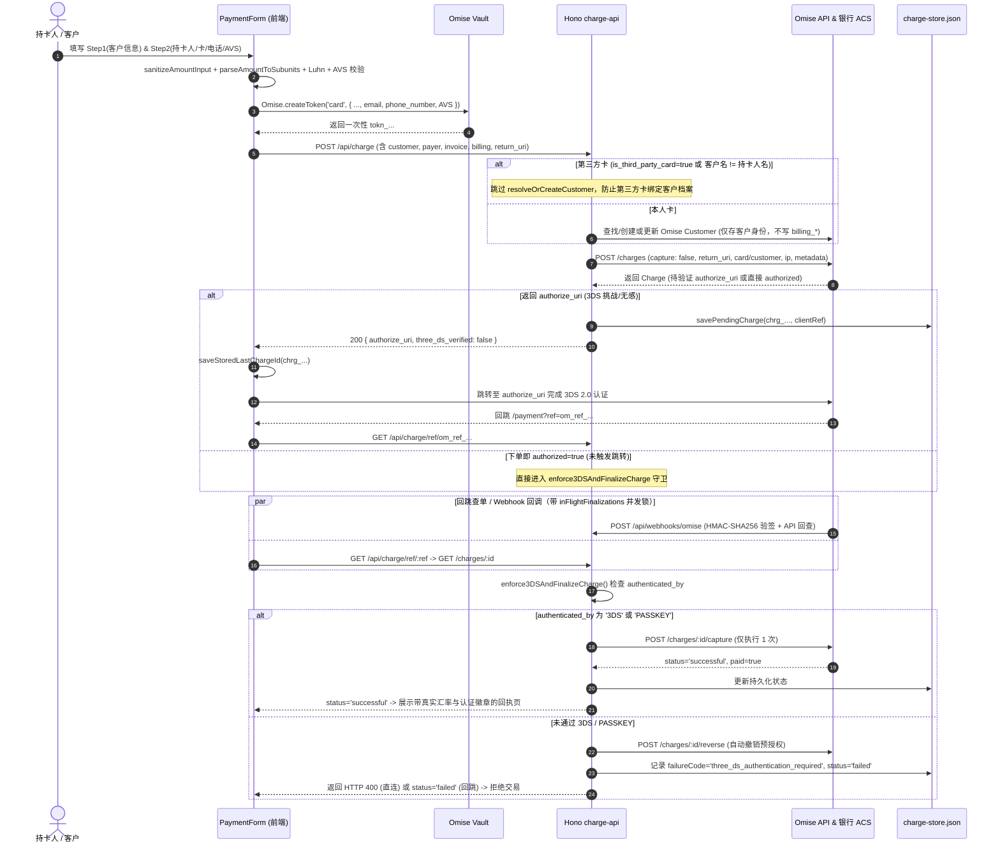

# OmisePay SG — 技术架构与项目文档

> 本文档基于当前 `main` 分支（提交 `8cd36cf`）实际代码状态编写，系统梳理项目定位、技术栈、目录结构、核心支付与 3DS 2.0 守卫流程、风控与合规机制、API 规范、部署方式以及上线前安全优化清单。

---

## 1. 项目概述

**OmisePay SG** 是一个基于 **Waku (React Server Components)** 与 **Hono** 构建的轻量级 **Omise Singapore (SG)** 多币种国际支付门户。项目支持国际信用卡与 Apple Pay on the Web，在保证前端敏感卡号不经过商户后端的前提下，实现了以下核心能力：

- **客户与持卡人彻底分离（Customer vs. Payer）**：支持第三方代付（用他人信用卡付款），并自动阻断第三方卡绑定至客户 Omise Customer 档案，避免“串卡”与账单地址污染。
- **多币种与卡组织合规校验**：默认结算与展示支持 **SGD（Visa / Mastercard / JCB）**，并原生支持 Omise Multi-Currency **USD / CAD（仅限 Visa / Mastercard）**，配备动态参考汇率换算（实时接口 + 安全回退）。
- **EMV 3D Secure 2.0 参数补全与后端预授权强拦截**：前端在 Token 化阶段注入 `email`、可选国际手机号 `phone_number` 及国际 AVS 地址；后端对普通银行卡默认使用 `capture: false` 预授权，并在确认 `authenticated_by` 为 `'3DS'` 或 `'PASSKEY'` 后自动 Capture 请款，对未经 3DS 认证的预授权自动 Reverse 撤单拒付。
- **Apple Pay on the Web（SG）**：服务端基于 Apple 商户身份证书与私钥执行 mTLS 商户验证，通过 `vault.omise.co/tokens` 执行 `applepay` Token 化，并按原生生物识别通道处理（不误触发 3DS 撤单）。
- **Webhook 异步回调验签与本地持久化**：严格使用 `crypto.timingSafeEqual` 校验 HMAC-SHA256 签名，结合事件去重与 `data/charge-store.json` 7 天 TTL 原子化磁盘持久化，确保 3DS 回跳与服务重启后订单状态可追溯。

---

## 2. 技术栈与工程配置

### 2.1 核心依赖（`package.json`）

| 类别 | 组件 / 依赖 | 版本 | 用途 |
| :--- | :--- | :--- | :--- |
| **应用框架** | `waku` | `1.0.0-rc.2` | 全栈 React Server Components 框架（RSC + SSR + SSG） |
| **UI 运行时** | `react` / `react-dom` / `react-server-dom-webpack` | `~19.3.0` | React 19 UI 渲染 |
| **React Compiler** | `babel-plugin-react-compiler` / `@rolldown/plugin-babel` | `^1.0.0` / `^0.2.4` | 编译期自动优化渲染性能 |
| **后端中间件** | `hono` | `^4.12.14` | Waku 服务端 `/api/*` 路由与请求处理 |
| **样式方案** | `tailwindcss` / `@tailwindcss/vite` | `^4.3.3` / `4.3.3` | Tailwind CSS v4 |
| **语言与检查** | `typescript` | `^6.0.3` | 严格静态类型检查 |
| **前端 SDK** | `Omise.js` (`https://cdn.omise.co/omise.js`) | 运行时加载 | 浏览器端银行卡数据直接 Token 化至 Omise Vault |
| **容器运行环境** | `node:22-alpine` + `nginx:alpine` | Docker Compose | 生产应用容器 + TLS 1.2/1.3 反向代理 |

### 2.2 TypeScript 严格模式（`tsconfig.json`）

项目开启了极严格的类型检查约束：
- `"strict": true`
- `"noUncheckedIndexedAccess": true`
- `"exactOptionalPropertyTypes": true`
- `"isolatedModules": true`、`moduleResolution: "bundler"`

---

## 3. 目录结构与模块说明

```text
/home/omisepay-prototype
├── Dockerfile                  # 多阶段构建镜像（node:22-alpine，暴露 3000 端口）
├── docker-compose.yml          # 编排 omisepay 应用与 nginx TLS 反代
├── nginx.conf                  # HTTP->HTTPS 强制跳转，TLSv1.2/TLSv1.3，透传真实 IP/协议头
├── .env.example                # 环境变量配置模板（生产密钥写在 .env 中且不入库）
├── .gitignore                  # 忽略 .env*、certs/、ssl/*.pem|crt|key、data/、dist/、*.tar.gz 等
├── .dockerignore               # 构建镜像时排除无关/敏感文件
├── waku.config.ts              # Waku + Vite + Tailwind + React Compiler 配置
├── package.json
├── tsconfig.json
├── certs/                      # Apple Pay Merchant Identity 证书与私钥挂载目录
├── ssl/                        # Nginx HTTPS fullchain.pem 与 privkey.pem 挂载目录
├── public/
│   ├── images/favicon.png
│   ├── robots.txt
│   └── .well-known/README.md   # Apple Pay 域名校验文件放置说明（apple-developer-merchantid-domain-association）
└── src/
    ├── global.d.ts
    ├── styles.css
    ├── config/
    │   ├── omise.ts            # 多币种配置（SGD/USD/CAD）、3DS 策略、卡组织限制、环境判定
    │   └── countries.ts        # 236 条国际国家/地区 AVS 规则（州省代码、邮编正则与格式化）
    ├── middleware/
    │   ├── charge-api.ts       # 核心 Hono API（配置下发、扣款、3DS 守卫、Apple Pay、Webhook、查单）
    │   └── no-trailing-slash.ts# 去除 URL 末尾斜杠重定向中间件
    ├── pages/
    │   ├── _layout.tsx         # 全局布局、Nunito 字体与站点 Meta 信息
    │   ├── index.tsx           # 动态首页（根据实时密钥环境展示 Live / Sandbox / 未配置状态）
    │   ├── payment.tsx         # 动态收银台页面，渲染 <PaymentForm />
    │   └── about.tsx           # 静态能力说明页（About OmisePay SG）
    ├── components/
    │   ├── header.tsx          # 顶部导航与多币种标签
    │   ├── footer.tsx          # 底部安全声明页脚
    │   └── payment-form.tsx    # 客户端核心收银台（客户/持卡人分离表单、校验、Apple Pay、3DS 状态机与回执）
    └── utils/
        ├── avs.ts              # 国际 AVS 地址校验与 Omise Token 标准化裁剪引擎
        ├── charge-store.ts     # 本地 JSON 原子持久化存储（交易索引、ref 映射、客户邮箱缓存、Webhook 去重）
        └── fx-rates.ts         # SGD 基准实时汇率拉取与缓存（open.er-api.com + 安全静态回退）
```

---

## 4. 系统架构与核心支付流程

### 4.1 整体系统拓扑

```mermaid
flowchart LR
    U["用户浏览器 / Safari (Apple Pay)"] -->|HTTPS TLS 1.2+| N["Nginx (nginx:alpine :80/:443)"]
    N -->|HTTP + X-Forwarded-* / CF-Connecting-IP| W["Waku SSR + Hono API (:3000)"]

    U -->|"Omise.createToken / tokenization[method]=applepay"| V["Omise Vault (vault.omise.co)"]
    V -->|tokn_...| U
    U -->|POST /api/charge / GET /api/charge/*| N

    W -->|GET/POST/PATCH Charges, Customers, Search| O["Omise API (api.omise.co)"]
    W -->|mTLS (certs/apcert.pem + apkey.pem)| A["Apple Pay Gateway (*.apple.com)"]
    W -->|GET /v6/latest/SGD| FX["open.er-api.com (FX Rates)"]
    W <-->|原子读写 7 天 TTL| DS["磁盘持久化 data/charge-store.json"]
    O -->|POST /api/webhooks/omise (HMAC-SHA256)| N
```

### 4.2 信用卡强制 3DS 2.0 预授权守卫流程



### 4.3 Apple Pay on the Web 流程摘要
1. 页面加载时检测 `window.ApplePaySession?.canMakePayments()`，符合条件展示 Apple Pay 按钮（`countryCode: 'SG'`、`merchantCapabilities: ['supports3DS', 'supportsCredit', 'supportsDebit']`）。
2. 点击付款后触发 `onvalidatemerchant` → 后端 `POST /api/applepay/validate-merchant` 读取 `APPLE_MERCHANT_CERT_PATH` / `APPLE_MERCHANT_KEY_PATH` 与苹果 `.apple.com` 验证域名完成 mTLS 握手。
3. 授权完成后前端携带 `tokenization[method]=applepay`、`tokenization[merchant_id]`、`tokenization[brand]` 与 `tokenization[data]` 请求 `https://vault.omise.co/tokens` 生成 `tokn_...`。
4. 后端收到 `is_apple_pay: true` 时保持 `capture: true`，并按配置 `OMISE_CONFIG.threeDS.enforceForApplePay = false` 豁免卡组织 3DS 拦截，由苹果设备端生物识别与支付 Cryptogram 担保授权；回执页展示 `✓ Apple Pay (Device Biometric)`。

---

## 5. 核心业务、风控与合规设计

### 5.1 客户与持卡人信息分离设计
| 维度 | 客户信息 (`customer` / Step 1) | 持卡人支付信息 (`payer` + `billing` / Step 2) |
| :--- | :--- | :--- |
| **表单字段** | 客户全名、客户邮箱（接收账单/收据）、金额、币种、账单描述 | 是否第三方卡开关、持卡人姓名、`Same as customer` 快捷填充、可选持卡人邮箱（勾选第三方卡或姓名不一致时自动展开）、可选持卡人国际手机号（3DS 2.0）、卡号/有效期/CVC、AVS 账单地址 |
| **Omise Customer 归属** | 仅**本人卡**支付时，依据标准化小写邮箱查询缓存/Search API，创建或 PATCH Omise Customer（`metadata` 仅存 `customer_name`、`invoice_number`、`registration_ip`、`last_ip`、`user_agent`，不混入 `billing_*`） | **第三方卡**支付（显式勾选 `is_third_party_card: true` 或 `customerName.toLowerCase() !== cardholderName.toLowerCase()`）完全跳过 Customer 创建与绑定，直接使用一次性 `tokn_...` |
| **Token 化联系字段** | 本人卡时作为 `Omise.createToken` 的 `email` | 第三方卡时仅使用填写的 `cardholderEmail`（不泄露客户邮箱）；如填写国际手机号，双方均写入 `tokenCardData.phone_number` 与 `metadata.cardholder_phone` |

### 5.2 多币种、限额与卡组织交叉限制（`src/config/omise.ts`）

| 币种 | 符号 | 金额范围（Subunits） | 支持的信用卡品牌 | Apple Pay 网络 |
| :--- | :--- | :--- | :--- | :--- |
| **SGD**（默认） | `S$` | `100` – `2,000,000` (`S$1.00` – `S$20,000.00`) | Visa、Mastercard、**JCB** | `visa`、`masterCard`、`jcb` |
| **USD** | `$` | `100` – `2,000,000` (`$1.00` – `$20,000.00`) | **仅限 Visa、Mastercard** | `visa`、`masterCard` |
| **CAD** | `CA$` | `100` – `2,000,000` (`CA$1.00` – `CA$20,000.00`) | **仅限 Visa、Mastercard** | `visa`、`masterCard` |

- **实时参考汇率**：`src/utils/fx-rates.ts` 从 `https://open.er-api.com/v6/latest/SGD` 拉取汇价，成功缓存 **1 小时**，超时/失败回退静态参考汇率（`SGD: 1, USD: 0.745, CAD: 1.035`）并在 **5 分钟**后重试。
- **防跨页参考汇率错乱**：回执页使用与 `chargeResult.amount` 和 `chargeResult.currency` 绑定的 `receiptCurrencyReference` 计算展示，避免 3DS 整页回跳后被重置的表单默认金额（`1500.00 SGD`）污染回执显示。

### 5.3 订单号、金额精度与卡号校验
- **订单号生成 (`generateOrderNumber`)**：格式为 `CBJ` + `13 位毫秒级时间戳` + `5 位随机字符`（通过 `crypto.getRandomValues` + Fisher-Yates 洗牌确保同时包含大写字母、小写字母与数字，不含任何 `-`），例如 `CBJ1795508855309kpj2B`。
- **金额精确处理**：
  - 前端 `sanitizeAmountInput()` 限制输入仅数字、最多 1 个小数点和最多 2 位小数，去除冗余前导零。
  - 前端 `parseAmountToSubunits()` 采用纯字符串拆分转换整数分值，彻底消除 `parseFloat * 100` 浮点误差。
  - 后端检验 `typeof amount === 'number' && Number.isSafeInteger(amount)`，拒绝浮点、负数及超限金额。
- **卡号与电话校验**：
  - 前端 `isValidLuhn()` 在 13–19 位卡号上执行 Luhn 模 10 校验，提前拦截单数字输错。
  - 前后端共同校验持卡人手机号满足国际 E.164 格式 `/^\+[1-9]\d{6,14}$/`。

### 5.4 国际 AVS 地址引擎（`src/utils/avs.ts` & `src/config/countries.ts`）
- 覆盖 236 条国际国家/地区配置，针对 US、CA、GB、SG、AU 等开启严格 AVS 提示与校验。
- 严格模式要求 `street1` 必须包含门牌号数字（`/\d/`），限制地址字段最大长度 50 字符、邮编 16 字符；支持美国 50+ 州/加拿大省区等二级行政区代码选择及邮编自动格式化。

### 5.5 前端状态机与回跳安全管理（`src/components/payment-form.tsx`）
- **状态集合 (`PaymentStatus`)**：`idle` → `tokenizing` → `charging` → `awaiting_3ds` → `verifying` → `pending` | `success` | `failed`。
- **防重复扣款 `pending` 独立页面**：3DS 回跳轮询默认最多查询 5 次（间隔 2 秒）。超时后进入琥珀色 **`Payment Processing — Do Not Pay Again`** 页面，提供 **Refresh Payment Status** 手动复核入口，不再误显示红色拒付引导用户二次付款。
- **`sessionStorage` 清理与轮询锁**：封装 `omise_last_charge_id` 读写清理函数，在所有终态（成功、失败、撤销、轮询超时、异常及 `handleReset` 重置）统一清除存储的交易 ID，并通过 `verifyRunIdRef` 与 `verifyTimerRef` 取消遗留定时器，避免页面重置或卸载后状态回弹。
- **真实认证徽章 (`getAuthenticationBadge`)**：根据 `authenticated_by` 与 `payment_method` 精确渲染 `✓ 3D Secure 2.0 (3DS)`、`✓ Passkey (3DS2)`、`✓ Apple Pay (Device Biometric)` 或 `⚠ Not 3DS Authenticated`。

### 5.6 Webhook 验签与磁盘持久化（`src/utils/charge-store.ts`）
- **签名验证**：支持 Omise `Omise-Signature`（逗号分隔多签名，Hex 与 Base64 编码，Base64 Secret 与 UTF-8 Secret 兼容）和 `<timestamp>.<rawBody>` / `<rawBody>` 负载组合，采用恒定时间比对 `crypto.timingSafeEqual`。
- **API 复核与幂等**：`processedEventIdsSet` + 最近 200 条 `webhookEvents` 拦截重复投递；处理前先 `GET /api/omise` 回查最新 Charge 状态，并联动 `enforce3DSAndFinalizeCharge` 自动 Capture 或 Reverse。
- **原子化磁盘持久化**：写入 `data/charge-store.json.<pid>.tmp` 后通过 `fs.renameSync` 原子替换 `data/charge-store.json`，自动清理超过 **7 天**的历史记录；同时维护 `chargesById`、`refToChargeId` 与 `customersByEmail` 映射。

---

## 6. 后端 API 接口参考（`src/middleware/charge-api.ts`）

| 方法与路径 | 功能说明 | 关键入参 / 头 | 主要响应字段 / 行为 |
| :--- | :--- | :--- | :--- |
| `GET /api/config` | 下发前端配置、支持币种、实时汇率与检测到的客户端 IP | — | `publicKey`, `applePayMerchantId`, `defaultCurrency`, `supportedCurrencies`, `currencyConfigs`, `exchangeRates`, `threeDSRequired`, `isConfigured`, `isLive`, `minAmount`, `maxAmount`, `clientIp` |
| `POST /api/charge` | 校验并创建扣款（含可选 Customer 处理、3DS 预授权守卫） | JSON: `token`, `amount`(整数分), `currency`, `return_uri`, `client_ref`, `card_brand`, `is_apple_pay`, `customer`, `payer`, `invoice`, `billing` | 返回 `200`（含 `authorize_uri` / 终态、`customer`、`payer`、`authenticated_by`、`three_ds_verified`、`payment_method`、`reversed`）；无 3DS 立即授权被拦截撤单则返回 `400` (`code: 'three_ds_authentication_required'`) |
| `GET /api/charge/ref/:ref` | 根据前端 `client_ref` 查询交易（先查磁盘存储，未命中再查 Omise Search API），并触发 3DS 捕获/撤单守卫 | 路径参数 `[a-zA-Z0-9_\-]+` | `formatChargeResponse` 格式化结果；未找到返回 `404` |
| `GET /api/charge/:id` | 根据 Omise Charge ID 查询交易（支持 Live `chrg_...` 与 Test `chrg_test_...`），同步执行 3DS 守卫 | 路径正则 `chrg_[a-zA-Z0-9_]+` | `formatChargeResponse` 格式化结果，保留已触发的 `three_ds_authentication_required` 拒付状态 |
| `POST /api/applepay/validate-merchant` | 使用 Apple Pay 商户证书与苹果服务器完成 mTLS 商户会话校验 | JSON: `validationUrl`（校验域名以 `.apple.com` 结尾） | 透传 Apple 签发的 `MerchantSession` JSON；缺少配置/证书返回 `503`/`500` |
| `GET /api/webhooks/omise` | 查看 Webhook 端点运行状态与最近事件摘要 | — | `{ status: 'active', endpoint, signatureVerificationConfigured, recentEventsCount, recentEvents }` |
| `POST /api/webhooks/omise` | 接收 Omise 异步事件（如 `charge.complete`） | Header: `omise-signature`, `omise-signature-timestamp` | HMAC 校验不通过返回 `401`；事件去重返回 `{ received: true, duplicate: true }`；正常处理触发 API 回查与 3DS 守卫并落盘 |

---

## 7. 环境变量与敏感资产（`.env.example`）

后端优先读取 `process.env`，若容器或进程未自动注入，则会动态解析工作目录下的 `.env` 文件。

| 变量名 | 是否必填 | 说明 |
| :--- | :--- | :--- |
| `OMISE_PUBLIC_KEY` | **必填** | Omise 公钥（Live `pkey_...` 或 Test `pkey_test_...`），仅用于前端 `Omise.js` 与 Apple Pay Vault Token 化 |
| `OMISE_SECRET_KEY` | **必填** | Omise 私钥（Live `skey_...` 或 Test `skey_test_...`），仅服务端持有，严禁下发前端 |
| `OMISE_CURRENCY` | 可选 | 默认币种，支持 `sgd` / `usd` / `cad`，默认 `sgd` |
| `OMISE_WEBHOOK_SECRET` | **生产推荐** | Omise Dashboard Webhooks 获取的签名密钥；配置后服务端严格拒收未验签或验签失败的回调 |
| `APPLE_MERCHANT_ID` | 可选 | Apple Pay Merchant Identifier（如 `merchant.co.omise.xxx`） |
| `APPLE_MERCHANT_CERT_PATH` | 可选 | 商户身份证书路径（支持相对或绝对路径，自动回退 `./certs/apcert.pem` 等） |
| `APPLE_MERCHANT_KEY_PATH` | 可选 | 商户私钥路径（自动回退 `./certs/apkey.pem` 等） |
| `APPLE_DISPLAY_NAME` | 可选 | 商户展示名称（默认 `Omise Pay`） |
| `APPLE_DOMAIN_NAME` | 可选 | 已向 Apple 注册验证的域名（不含 `https://`，默认取请求 `Host`） |

**生产证书与存储挂载路径（Docker Compose）：**
- `./.env` → `/app/.env:ro`
- `./certs` → `/app/certs:ro`（存放 Apple Pay `apcert.pem` / `apkey.pem`）
- `./data` → `/app/data`（持久化 `charge-store.json`）
- `./ssl` → `/etc/nginx/ssl:ro`（存放 HTTPS `fullchain.pem` 与 `privkey.pem`）

---

## 8. 本地开发与 Docker 生产部署

### 8.1 本地开发与构建命令

```bash
# 安装依赖
npm ci

# 启动开发服务器
npm run dev

# TypeScript 严格类型检查
./node_modules/.bin/tsc --noEmit

# 生产构建（输出 dist/ 含 RSC、SSR、Client 与 SSG 产物）
npm run build

# 启动生产 SSR 服务（默认 3000 端口）
npm run start
```

### 8.2 Docker 生产部署（`docker-compose.yml` + `nginx.conf`）

1. **确保生产服务器存在以下敏感文件**（均已被 `.gitignore` 排除出 Git 仓库）：
   - `.env`（配置正式 Omise 密钥与 Webhook Secret）
   - `ssl/fullchain.pem` 与 `ssl/privkey.pem`（域名 HTTPS 证书，对应 `nginx.conf` 中的 `server_name pay.cyberjar.io`）
   - `certs/` 中的 Apple Pay 证书与私钥（如启用 Apple Pay）
2. **重新打包部署压缩包**（注意：当前根目录原有的 `omisepay-deploy.tar.gz` 打包于早期版本，部署最新 `8cd36cf` 代码前建议在本地执行以下命令重新生成）：
   ```bash
   tar -czf omisepay-deploy.tar.gz \
     package.json package-lock.json tsconfig.json waku.config.ts \
     Dockerfile docker-compose.yml nginx.conf .dockerignore \
     .env .env.example .gitignore README.md LICENSE \
     certs ssl public src
   ```
3. **在生产服务器解压并启动容器**：
   ```bash
   tar -xzf omisepay-deploy.tar.gz
   docker compose up -d --build
   docker compose ps
   ```
   > `omisepay` 容器仅绑定宿主 `127.0.0.1:3000:3000`，公网流量统一经 `omisepay-nginx`（`80` 跳 `443`）接入。
4. **Omise SG Dashboard Webhook 配置**：
   - Endpoint URL：`https://pay.cyberjar.io/api/webhooks/omise`

---

## 9. 已知待完善项与上线前安全建议（Roadmap）

经全量代码安全审查，当前所有 P0 功能与已知界面/计算 Bug 均已修复并通过类型与构建验证；但在高并发或公网正式长期运营前，仍建议按以下优先级推进加固：

### P1（公网上线前高优先级安全与风控建议）
1. **防刷卡攻击（Card Testing）限流**：目前 `nginx.conf` 与 `charge-api.ts` 未限制 `/api/charge` 请求频率。建议在 Nginx 增加 `limit_req_zone`（按 IP 限流每分钟 5–10 次），并在后端对同 IP/同邮箱连续失败加冷却机制或前端接入人机验证（如 Turnstile）。
2. **Webhook 时间戳防重放**：`verifyOmiseSignature` 当前允许缺失 `Omise-Signature-Timestamp` 回退，且未校验时间戳窗口。建议强制校验时间戳与服务器当前时间差在 `±300` 秒内，避免过期事件被重放。
3. **收紧公开查询接口的 PII 暴露（PDPA 合规）**：
   - `GET /api/webhooks/omise` 对外返回最近 10 笔记录的 `chargeId`、`status`、`paid`，建议加访问令牌保护或仅返回健康状态 `{ status: 'ok' }`；
   - `GET /api/charge/:id` 无鉴权直接返回客户与持卡人姓名/邮箱及卡后四位，建议改用高熵 `crypto.randomUUID()` 令牌或签名回执参数鉴权。
4. **收紧 `return_uri`、代理 IP 与 Apple Pay URL 白名单**：
   - 限制 `return_uri` 的协议与域名必须属于本站白名单（如 `https://pay.cyberjar.io`），杜绝 3DS 开放重定向；
   - 若源站未限制仅允许 Cloudflare IP 回源，应移除 `nginx.conf` 对未认证请求头 `$http_cf_connecting_ip` 的透传以及后端 `body.client_ip` 的回退读取，防止伪造风控 IP；
   - 收紧 Apple Pay `validationUrl`，增加 `protocol === 'https:'` 及 Apple 官方网关主机白名单正则检查。
5. **补充 Nginx 安全响应头与 PCI-DSS 合规说明**：
   - 在 `nginx.conf` 配置 `Strict-Transport-Security`、`X-Frame-Options: DENY`、`X-Content-Type-Options: nosniff`、`Referrer-Policy` 以及严格 `Content-Security-Policy`（仅允许 `'self'`、`https://cdn.omise.co`、`https://vault.omise.co` 等必需源）；
   - **合规提示**：当前页面直接托管 `<input>` 收集卡号再调用 `Omise.createToken`，按 PCI SSC 分类属于 **SAQ A-EP**（需遵守 PCI-DSS 4.0 支付页脚本完整性 6.4.3 / 11.6.1 等控制要求）；若后续希望降级为最轻量的 **SAQ A**，可改用 Omise Hosted Payment Page 或 iFrame 托管控件。

### P2（工程健壮性优化）
1. **服务端下单幂等性**：对相同 `client_ref` / `invoice_number` 在扣款中或已成功状态拦截重复创建 Charge。
2. **固定 `Omise-Version` 请求头**：在访问 `api.omise.co` 时显式声明版本号，防止账号设置升级引起数据结构漂移。
3. **Apple Pay 细节增强**：将 `ApplePaySession` 的 `total.label` 与后端 `/api/config` 下发的 `APPLE_DISPLAY_NAME` 保持一致，并按需通过 `requiredBillingContactFields` 补充持卡人账单联系信息。
4. **持久化存储与容器降权**：多实例水平扩展时需将 `data/charge-store.json` 替换为 SQLite / PostgreSQL / Redis；`Dockerfile` 生产运行阶段建议切换至非 root 用户（`USER node`）。
